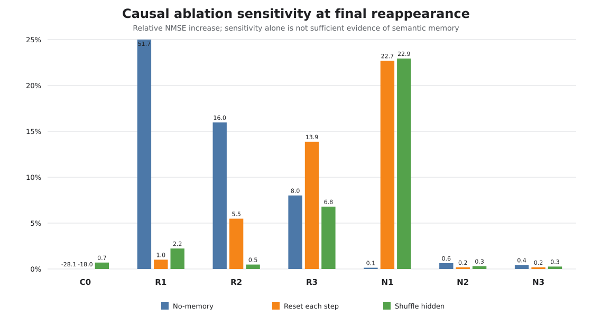
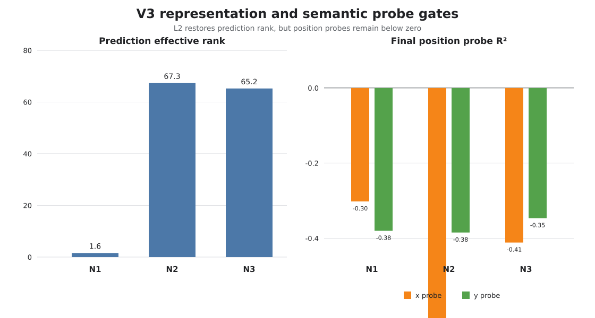

# LeWorldModel：遮挡条件下的因果工作记忆审计

> **当前结论：** 截至 2026-08-04，完整的 C0–R3 与 V3 N1–N3 实验都没有提供可靠的、对象特定的因果工作记忆证据。N1 对 hidden shuffle 很敏感，但 prediction representation 塌缩且 no-memory gate 几乎不变；N2/N3 提高了 prediction rank，却没有恢复位置语义或 matched-future direction。

## English abstract

This repository studies whether LeWorldModel genuinely uses recurrent state to bridge visual occlusion, rather than exploiting visibility, timing, dataset ambiguity, or representation shortcuts. We introduce a strict recurrent bottleneck, paired occlusion datasets, and causal evaluation gates combining hidden-state interventions, normalized prediction error, effective rank, physical-state probes, and matched-future direction. A seemingly positive C0–R3 result was invalidated by a dataset identifiability audit. On the corrected V3 datasets, all three completed 25-epoch candidates failed the preregistered selection gates (`selected=null`). The current evidence therefore does not support object-specific causal working memory; the next frozen step is a visible-frame representation gate.

## 研究问题

模型在物体消失后再次出现时，预测变好究竟是因为它使用了跨遮挡记忆，还是因为：

- 当前帧、绝对时间或 reveal schedule 已经泄漏了答案；
- 数据本身在相同输入下对应多个不同 future；
- latent loss 下降，但 prediction representation 退化或发生 target co-adaptation；
- 递归状态被扰动会影响模型，却没有携带正确的对象位置与运动方向。

因此，本项目不把低 loss、单一 shuffle 指标或线性可解码性直接等同于“拥有工作记忆”。

## 与上游 LeWM 的边界

本仓库保留 [Lucas Maes 等人的上游 LeWorldModel](https://github.com/lucas-maes/le-wm) 历史与 MIT License。上游工作的核心是稳定的端到端 joint-embedding predictive world model；本阶段研究聚焦于一个更窄的问题：**如何验证 recurrent state 是否在遮挡任务中携带因果、对象特定的未来信息。**

本阶段新增内容主要包括：

- OOT 遮挡任务与严格 recurrent bottleneck；
- primitive-v2 / primitive-v3 数据生成、paired comparison 和 identifiability audit；
- no-memory、reset、hidden-shuffle、effective-rank、physical probe 与 matched-future audit；
- C0–R3、V3 N1–N3 campaign、selector、测试和证据化结果整理。

这些扩展不代表上游作者对本仓库实验结论的背书。

## 方法：把“依赖状态”与“记住正确内容”分开

严格瓶颈采用：

```text
s_t       = Encoder(o_t)
h_t       = LeakyRNN(h_(t-1), concat(s_t, E(a_(t-1))))
s_hat_t+1 = PointwisePredictor(concat(h_t, E(a_t)))
```

predictor 不包含 temporal module、position parameter 或 visual residual bypass。实验只有在以下证据同时健康时，才允许接近“因果工作记忆”解释：

1. final-reappearance NMSE 不劣于同数据均值基线；
2. no-memory、reset 与 shuffled-hidden 干预方向一致，shuffle bootstrap CI 下界大于 0；
3. target、prediction 与 hidden representation 不塌缩；
4. x/y/angle 等 physical probe 不因 latent objective 改变而退化；
5. matched-future pair 的预测差异沿真实 future 差异方向变化。

## 四个关键研究转折

| 转折 | 当时解决的问题 | 证据与结论 | 当前定位 |
|---|---|---|---|
| 早期 OOT / Leaky-RNN | 建立遮挡、递归状态与 action alignment | e100 完整，但属于严格瓶颈前实现 | 历史起点，不作 corrected baseline |
| normalization / collapse 排查 | 解释低 loss 与表示退化 | main25 完整；多组 2–5 epoch 尝试被中止 | 保留失败总结，partial checkpoint 待确认清理 |
| C0–R3 严格瓶颈 | 排除 visual/temporal bypass | R3 shuffle +6.79%，但 direction alignment 约为 0 | 看似阳性，机制证据否定 |
| Dfinal audit → V3 | 修复数据不可辨识与 reveal 设计 | 旧 Dfinal 99.9875% episode 落入冲突组；V3 三个正式 run 仍未过 gate | 当前最可信负结论 |

完整状态与证据分类见 [实验发展历程](docs/experiment-history.md)。

## C0–R3：看似阳性的 R3 为什么被推翻

| Run | Dataset | Final NMSE | Shuffle 增幅 | Prediction rank | x / y probe R² | Pair separation | Direction alignment |
|---|---:|---:|---:|---:|---:|---:|---:|
| C0 | d0 | 1.7478 | 0.70% | 90.13 | -0.096 / -0.022 | — | — |
| R1 | dshort | 1.5188 | 2.23% | 107.48 | -0.101 / -0.136 | — | — |
| R2 | dmid | 1.6926 | 0.49% | 76.55 | -0.172 / -0.226 | — | — |
| R3 | dfinal | 1.5835 | 6.79% | 131.99 | -0.322 / -0.315 | 0.5748 | -0.00094 |

R3 的 shuffle 增幅越过了 5% 阈值，但 matched-future direction 几乎为零；模型的输出差异没有沿正确 future 方向变化。随后数据审计又发现旧 Dfinal 的 identifiability 缺陷，因此“R3 已学会跨遮挡记忆”这一解释被撤回，而不是隐藏。

原始数值：[summary.csv](results/summary.csv)；R3 audit：[results/manifests/audits/R3](results/manifests/audits/R3/validation_own/)。



## V3：数据修正后仍未出现可靠工作记忆

V3 固定第一段 H4 遮挡，设置五种均衡 reveal 时刻，将随机 onset 的 target weight 设为 0，并对 original-motion / motion15x 做 paired audit。N1 是主参考配置；N2/N3 只是 stop-gradient 与 motion-amplitude ablation，不是“优胜模型”。

| Run | 配置 | Final NMSE | No-memory | Reset | Shuffle | Prediction rank | x / y probe R² | Direction alignment |
|---|---|---:|---:|---:|---:|---:|---:|---:|
| N1 | original + L1 | 1.0023 | +0.14% | +22.69% | +22.93% | 1.56 | -0.302 / -0.380 | 0.0297 |
| N2 | original + L2 | 1.0008 | +0.63% | +0.18% | +0.30% | 67.32 | -0.732 / -0.385 | 0.0227 |
| N3 | motion15x + L2 | 1.0005 | +0.44% | +0.18% | +0.26% | 65.22 | -0.411 / -0.347 | 0.0155 |

N1 的 reset/shuffle 敏感性很强，但 prediction effective rank 只有 1.56、top-1 variance ratio 为 0.9449，且 no-memory 几乎不变；这更像对状态组织方式的脆弱依赖，而不是可验证的对象记忆。N2/N3 将 rank 恢复到约 65–67，却没有恢复位置 probe、matched-future direction 或明显的 memory ablation 效应。

从现存 raw audit 重建 selector 后，结果为 [`selected=null`](results/manifests/selection_decision.json)。原 selection 文件在远程机缺失，重建过程及 SHA256 单独记录在 [provenance](results/manifests/selection_decision.provenance.json) 中。



## 当前结论、失败与限制

- 已确认：C0–R3、N1–N3 均完成 25 epochs，存在最终 checkpoint SHA256、run record 与完整 audit。
- 已否定：R3 的单一 shuffle 阳性不能证明正确 future direction；旧 Dfinal 的 acceptance 也不足以保证可辨识性。
- 当前负结论：没有一个 V3 候选同时通过 performance、representation、physical-probe 与 causal-memory gate。
- 尚未执行：N4/N5 replication 和 visible-frame representation gate。
- 仍有限制：motion15x 是对既有轨迹的 coherent transform，不是新 simulator draw；first occlusion 在 V3 中仍固定；所有正式筛选目前只有 seed 3072。

## 唯一冻结的下一步

先运行 **visible-frame representation gate**：在没有遮挡、无需记忆的可见帧上，检查 encoder 是否已编码 x/y、angle 与 velocity。

- 如果可见帧 probe 也失败，优先处理 encoder / projector / pretraining；
- 如果可见帧 probe 健康而遮挡后失败，再调整 recurrent state 或 prediction objective；
- 在 gate 完成前，不把 N4/N5、扩大模型或更多 loss 组合描述为已启动工作。

该方向状态为 `planned`，没有 artifact。

## 复现与仓库内容

```bash
python -m pip install -r requirements.txt
python -m pytest -q -p no:cacheprovider tests
python analysis/select_occlusion_v3_winner.py \
  --campaign-root results/manifests/v3-selector-input \
  --output /tmp/selection_decision.json
```

详细环境、目录约定与训练入口见 [reproducibility.md](docs/reproducibility.md)。GitHub 只包含源码、配置、测试、精选 audit、图和 SHA256 manifest；所有 `.h5`、`.pt`、`.ckpt`、`.npz`、原始日志与压缩归档均被排除。

## 引用与许可证

代码沿用上游 MIT License。若使用本阶段的遮挡数据设计、严格瓶颈或因果审计，请同时引用本仓库的 `CITATION.cff` 与上游 LeWorldModel 工作。
